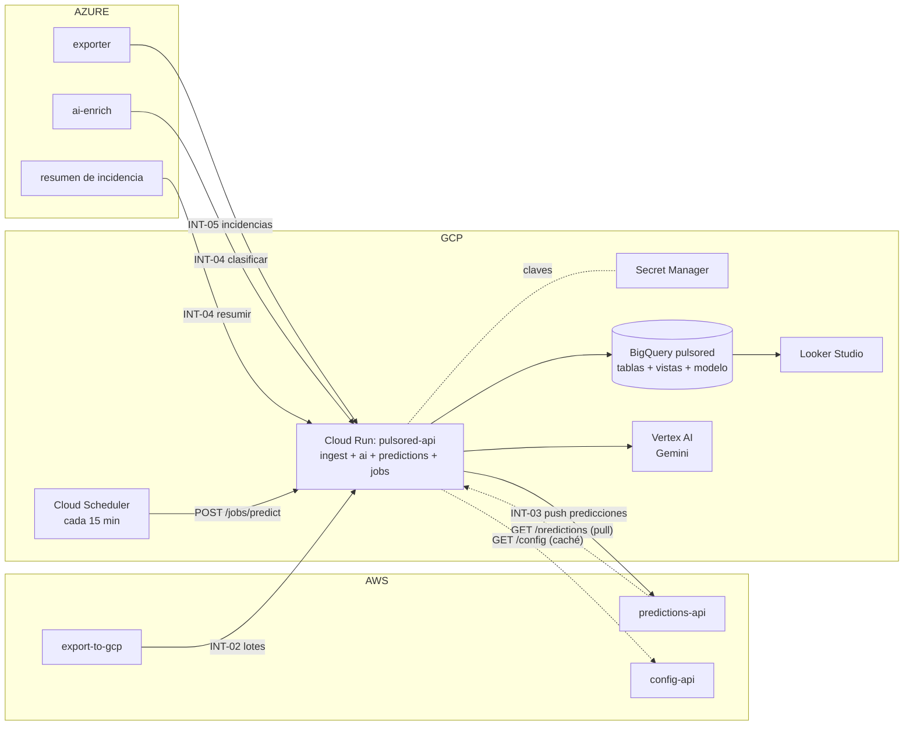

# Módulo GCP — Especificación completa (Data Engineering, Analytics e IA)

> Documento **interno**. Fuente única para el módulo GCP. Usa la **numeración del README del equipo (RF-GCP-01…20)** y añade RF-GCP-21…31. Si algo choca con `REQUISITOS.md §3`, **manda este archivo**.
> **P:** M = MVP · E = extra. Los puntos marcados **[D1]/[D3]** dependen de decisiones del equipo (D1: IA generativa incluida; D3: Azure acepta los 7 tipos de evento). Adoptadas por defecto en `docs/AWS.md` §0.

---

## 1. Qué hace GCP en una frase

GCP **recibe** datos de AWS (antenas) y Azure (reportes e incidencias), los **guarda y analiza**, **predice fallas** de antenas y las **envía a AWS**, y ofrece **IA de texto** (clasificar y resumir) a Azure. Nunca está en la ruta crítica de nadie: si GCP cae, AWS y Azure siguen funcionando.

---

## 2. Requerimientos finales

### A. Ingesta y almacenamiento
| ID | Requerimiento | P | Cómo se resuelve |
|---|---|---|---|
| RF-GCP-01 | Recibir métricas de tráfico y estados de antenas desde **AWS** | M | `POST /ingest/telemetry`, `POST /ingest/events` |
| RF-GCP-02 | Recibir incidencias (individuales y colectivas) desde **Azure**: usuarios afectados, ubicación, tipo, prioridad, estado | M | `POST /ingest/incidents` |
| RF-GCP-03 | **Validar** estructura, integridad y consistencia: IDs de antena/zona/incidencia contra el catálogo, marcas temporales | M | Validación en el servicio; lo inválido va a la tabla `rejects` y se devuelve en la respuesta |
| RF-GCP-04 | Almacenar de forma persistente el histórico | M | BigQuery, tablas append-only particionadas por fecha |
| RF-GCP-05 | Integrar AWS y Azure: relacionar métricas de antenas con incidencias por zona y periodo | M | Vista `v_zone_timeline` (por zona y bloques de 15 min) |

### B. Procesamiento y analítica
| ID | Requerimiento | P | Cómo se resuelve |
|---|---|---|---|
| RF-GCP-06 | Procesar, transformar y organizar el histórico | M | Vistas de deduplicación `*_dedup` + vistas analíticas |
| RF-GCP-07 | Zonas con más incidencias y usuarios afectados | M | `v_zone_ranking` |
| RF-GCP-08 | Antenas con más fallas, degradaciones y saturaciones | M | `v_antenna_problems` |
| RF-GCP-09 | Tipos de problema más frecuentes y su recurrencia en el tiempo | M | `v_problem_types`, `v_recurrence` |
| RF-GCP-10 | Correlación entre métricas de antenas e incidencias | M | `v_correlation` (CORR por zona, desfase entre primera anomalía y primer reporte) |
| RF-GCP-11 | Visualización: indicadores, gráficos y estadísticas | M | Looker Studio |
| RF-GCP-12 | Visualización geoespacial de antenas e incidencias | M | Mapa en Looker Studio sobre `v_geo` |

### C. IA y predicción
| ID | Requerimiento | P | Cómo se resuelve |
|---|---|---|---|
| RF-GCP-13 | Preparar datos para ML | M | Vista `v_features` (reproducible) |
| RF-GCP-14 | Entrenar modelos predictivos | M | BigQuery ML `BOOSTED_TREE_CLASSIFIER` |
| RF-GCP-15 | Estimar la probabilidad de falla/degradación en un horizonte | M | `ML.PREDICT` cada 15 min; horizonte 60 min |
| RF-GCP-16 | Registrar predicciones: antena, probabilidad, **estado previsto**, horizonte, `model_version` | M | Tabla `predictions` |
| RF-GCP-17 | Actualizar y reentrenar con datos nuevos | M | Endpoint `POST /jobs/retrain` (manual en MVP; programado como extra); versión nueva por entrenamiento en `model_registry` |

### D. Integración y comunicación
| ID | Requerimiento | P | Cómo se resuelve |
|---|---|---|---|
| RF-GCP-18 | Exponer predicciones para que AWS las **consulte o reciba** | M | `GET /predictions` **y** push (RF-GCP-19) |
| RF-GCP-19 | Enviar a AWS las predicciones que cumplan las condiciones de alerta | M | Tras cada predicción: `POST` a AWS con las de probabilidad ≥ `PRED_SEND_MIN` (0.50). AWS decide la alerta (≥ 0.70 y ≤ 24 h) |
| RF-GCP-20 | Consulta de resultados por usuarios autorizados | M | Looker Studio compartido solo con correos del equipo/jurado |

### E. Añadidos (de mi propuesta)
| ID | Requerimiento | P | Cómo se resuelve |
|---|---|---|---|
| RF-GCP-21 | **Histórico sintético** de ~30 días con patrones realistas | M | `tools/seed_history.py` |
| RF-GCP-22 | Minimizar costo de consulta | M | Partición por fecha, cluster por zona/antena, `maximum_bytes_billed` |
| RF-GCP-23 | **Clasificar reportes** con IA: categoría normalizada, urgencia, mención de sitio crítico, JSON validado **[D1]** | M | `POST /ai/classify-report` (Gemini) |
| RF-GCP-24 | **Resumen, hipótesis de causa y acción recomendada** de una incidencia **[D1]** | M | `POST /ai/summarize-incident` (Gemini) |
| RF-GCP-25 | **Calidad de IA**: esquema validado, timeout corto, caché, límite de cuota, `model_version`, **sin datos personales en prompts** | M | Capa común del servicio |
| RF-GCP-26 | Detección de anomalías no supervisada | E | BigQuery ML `ARIMA_PLUS` |
| RF-GCP-27 | Pronóstico de incidencias por zona | E | `ARIMA_PLUS` / `ML.FORECAST` |
| RF-GCP-28 | Embeddings y similitud para agrupar reportes semejantes | E | Vertex AI embeddings + `VECTOR_SEARCH` |
| RF-GCP-29 | Consultas en lenguaje natural sobre el histórico (solo lectura) | E | `POST /ai/ask` |
| RF-GCP-30 | Redacción de notificaciones por etapa | E | `POST /ai/notification-text` |
| RF-GCP-31 | Evaluar el modelo y comparar predicciones contra fallas reales | E | `v_prediction_outcomes` |

**Equivalencias con `REQUISITOS.md §3`:** 01→01 · 02→02 · 03→21 · 04→22 · 05→14 · 06→15 · 07→16,19 · 08→31 · 09→26 · 10→27 · 11→23 · 12→24 · 13→25 · 14→30 · 15→28 · 16→29 · 17→06,07,08,09 · 18→11,20 · 19→03 · 20→05 · 21→10 · 22→12 · 23→13 · 24→17 · 25→18.

---

## 3. Componentes en GCP



**Un solo servicio Cloud Run (`pulsored-api`)** en lugar de varios: un solo despliegue, un solo secreto y un solo contrato. Escala a cero y está dentro de la capa gratuita.

### Estructura del repo (GCP)
```
gcp/
  api/        main.py, auth.py, schemas.py, bq.py, ai.py, predict.py, config.py
  sql/        01_tables.sql  02_views.sql  03_features.sql  04_train.sql  05_predict.sql
  tools/      seed_history.py  load_zones.py
  deploy.sh
contracts/    openapi-gcp.yaml  events/*.json  enums.json  zones.json
```

---

## 4. Conexiones: quién llama a quién

| ID | Quién llama | A quién | Endpoint | Si falla |
|---|---|---|---|---|
| INT-02 | **AWS** | GCP | `POST /ingest/telemetry` · `POST /ingest/events` | AWS acumula y reintenta (RF-AWS-19) |
| INT-05 | **Azure** | GCP | `POST /ingest/incidents` | Azure reintenta |
| INT-04 | **Azure** | GCP | `POST /ai/classify-report` · `POST /ai/summarize-incident` | GCP responde `503` rápido; Azure usa reglas |
| INT-03 | **GCP** | AWS | `POST {AWS}/predictions` | GCP reintenta 3 veces; la próxima ejecución (15 min) reenvía |
| INT-03b | **AWS** | GCP | `GET /predictions` (opcional) | AWS usa lo último recibido |
| INT-06 | **GCP** | AWS | `GET {AWS}/config` | Caché de 5 min + valores por defecto |

**Reglas comunes**
- Autenticación: cabecera `X-API-Key`. Cada llamante tiene su propia clave (AWS, Azure). GCP las valida contra Secret Manager. Las claves que GCP usa hacia AWS se guardan en **AWS Secrets Manager** y la copia de GCP en Secret Manager.
- Todo mensaje lleva el **sobre común** (abajo). Entrega **al menos una vez** → GCP es **idempotente por `event_id`**.
- Códigos: `202` aceptado (puede traer rechazos parciales), `400` sobre inválido (**no reintentar**), `401` clave inválida, `429` (reintentar con `Retry-After`), `5xx` (reintentar con espera creciente).
- Fechas en ISO-8601 UTC. IDs de zona/antena según `contracts/zones.json`.
- **Sin datos personales** hacia GCP: nunca documento, teléfono ni correo. El usuario viaja como `user_key` hash (SHA-256 con sal compartida).

### Sobre común
```json
{
  "event_id": "5b0e6c9e-2f3a-4f7e-9a0e-0d6c1c0f7a11",
  "type": "telemetry.batch",
  "schema_version": "1.0",
  "source": "aws",
  "occurred_at": "2026-11-20T15:04:00Z",
  "correlation_id": "c1f0a9b2-...",
  "payload": { }
}
```

### 4.1 AWS → GCP
**`POST /ingest/telemetry`** (`type: telemetry.batch`, ~60 muestras cada 5 min)
```json
"payload": { "samples": [
  { "antenna_id": "ANT-LIM-004", "zone_id": "LIM-SURCO", "ts": "2026-11-20T15:03:00Z",
    "gb_per_min": 87.4, "state": "NORMAL" } ] }
```
**`POST /ingest/events`** (`type: antenna.event`)
```json
"payload": { "antenna_id": "ANT-LIM-004", "zone_id": "LIM-SURCO",
  "event_type": "FALLA", "severity": "ALTA",
  "previous_state": "NORMAL", "new_state": "CAIDA", "gb_per_min": 41.2,
  "first_anomaly_at": "2026-11-20T15:01:00Z" }
```
`event_type`: `FALLA | DEGRADACION | SATURACION | RECUPERACION | PREVENTIVA | ESTRUCTURAL | PROLONGADA`.
**Respuesta común:** `202 {"accepted": 58, "duplicates": 2, "rejected": [{"index": 3, "reason": "unknown_antenna"}]}`

### 4.2 Azure → GCP
**`POST /ingest/incidents`** (`type: incident.upsert` o `report.upsert`)
```json
"payload": { "incident_id": "INC-2026-000123", "incident_type": "COLECTIVA",
  "origin": "AMBOS", "zone_id": "LIM-SURCO", "status": "EN_ATENCION",
  "priority_level": "ALTA", "priority_score": 68,
  "users_affected": 14, "report_count": 17,
  "opened_at": "...", "first_report_at": "...", "first_anomaly_at": "...",
  "detected_by": "AMBOS", "detection_lag_s": 240,
  "resolved_at": null, "closed_at": null,
  "ai_summary": "..." }
```
```json
"payload": { "report_id": "REP-...", "zone_id": "LIM-SURCO", "incident_id": "INC-...",
  "declared_category": "SIN_INTERNET", "ai_category": "SIN_INTERNET", "ai_urgency": "ALTA",
  "classification_source": "gemini", "status": "REGISTRADA",
  "created_at": "...", "occurred_at": "...", "user_key": "9f2c...hash" }
```
Se envía en cada cambio (upsert); GCP guarda todas las versiones y las vistas toman la última.

**`POST /ai/classify-report`** — sincrónica, la llama Azure **después** de guardar el reporte.
```json
// request (sin documento, teléfono ni correo)
{ "report_id": "REP-...", "text": "Desde ayer no tengo internet, soy del colegio San Juan",
  "declared_category": "SIN_INTERNET", "zone_type": "EDUCATIVA" }
// response 200
{ "report_id": "REP-...", "category": "SIN_INTERNET", "urgency": "ALTA",
  "critical_site": { "mentioned": true, "kind": "COLEGIO" },
  "confidence": 0.91, "model_version": "gemini-<modelo>", "source": "gemini" }
// error
503 { "error": "ai_unavailable" }   // Azure cae a reglas
```
**`POST /ai/summarize-incident`**
```json
// request
{ "incident_id": "INC-...", "incident_type": "COLECTIVA",
  "zone": { "id": "LIM-SURCO", "name": "Surco", "type": "SALUD" },
  "users_affected": 14, "first_report_at": "...", "priority_level": "ALTA",
  "antenna_evidence": [ { "antenna_id": "ANT-LIM-004", "state": "CAIDA", "since": "..." } ],
  "report_samples": [ "sin internet desde las 3", "no hay señal" ] }   // máx. 10, sin datos personales
// response
{ "summary": "...", "probable_cause": "...", "recommended_action": "...", "model_version": "..." }
```
Timeouts recomendados para Azure: **4 s** en clasificar, **8 s** en resumir.

### 4.3 GCP → AWS y AWS → GCP (predicciones)
**GCP envía** (`POST {AWS}/predictions`, `type: prediction.batch`):
```json
"payload": { "model_version": "failure_model_v3", "generated_at": "2026-11-20T15:15:00Z",
  "predictions": [
    { "antenna_id": "ANT-LIM-004", "zone_id": "LIM-SURCO", "probability": 0.83,
      "predicted_state": "CAIDA", "horizon_minutes": 60,
      "valid_until": "2026-11-20T16:15:00Z" } ] }
```
**AWS consulta (opcional):** `GET /predictions?zone_id=&antenna_id=&min_probability=0.5` → misma estructura.
**Quién decide la alerta:** GCP solo envía las de `probability ≥ PRED_SEND_MIN`. **AWS** aplica la regla de alerta (`≥ 0.70` y `horizonte ≤ 24 h`) y genera la alerta preventiva.

### 4.4 Configuración global (AWS → GCP)
GCP lee `GET {AWS}/config` al arrancar y cada 5 min; si falla usa el último valor o estos por defecto:
`THRESHOLD_DOWN=60 · THRESHOLD_SATURATED=129 · PRED_SEND_MIN=0.50 · PRED_ALERT_MIN=0.70 · PRED_HORIZON_MIN=60 · ZONES_VERSION`.

### 4.5 Enumeraciones compartidas (`contracts/enums.json`)
`antenna_state`: NORMAL, CAIDA, INHABILITADA, SATURADA · `severity`: BAJA, MEDIA, ALTA, CRITICA, INFO · `incident_type`: COLECTIVA, INFRAESTRUCTURA, PREVENTIVA, ESTRUCTURAL · `status`: REGISTRADA, EN_REVISION, EN_ATENCION, SOLUCIONADA, CERRADA · `category`: SIN_INTERNET, INTERNET_LENTO, SIN_SENAL, LLAMADAS, SMS, OTRO · `zone_type`: RESIDENCIAL, COMERCIAL, INDUSTRIAL, EDUCATIVA, SALUD, CRITICA.
*(La categoría la define Azure en su portal; hay que fijar esta lista **hoy** para los tres.)*

---

## 5. Datos en BigQuery (dataset `pulsored`, ubicación `US`)

| Tabla | Contenido | Partición / cluster |
|---|---|---|
| `telemetry` | muestras de AWS | día de `ts` / `antenna_id` |
| `antenna_events` | cambios de estado y alertas | día / `antenna_id` |
| `reports` | versiones de cada reporte | día de `created_at` / `zone_id` |
| `incidents` | versiones de cada incidencia | día de `opened_at` / `zone_id` |
| `predictions` | predicciones con `model_version` y `push_status` | día de `generated_at` / `antenna_id` |
| `model_registry` | modelo, fecha, métricas de evaluación | — |
| `rejects` | filas inválidas y motivo | día |
| `zones`, `antennas` | catálogo cargado de `zones.json` | — |

Todas incluyen `event_id`, `source` e `ingested_at`. **Idempotencia:** las tablas son *append-only* (`insert_rows_json` con `row_ids`) y las vistas `*_dedup` se quedan con la última fila por clave (`QUALIFY ROW_NUMBER() … = 1`), así un reintento nunca duplica resultados.

**Vistas:** `v_zone_ranking`, `v_antenna_problems`, `v_problem_types`, `v_recurrence`, `v_zone_timeline`, `v_correlation`, `v_incident_durations`, `v_mttd`, `v_geo`, `v_features`, `v_prediction_outcomes`.

---

## 6. Modelo predictivo (BigQuery ML)

- **Etiqueta:** el peor estado observado en los siguientes 60 min: `NORMAL / SATURADA / CAIDA / INHABILITADA`.
- **Características** (`v_features`, por antena y minuto): promedio 15 y 60 min, **pendiente** de 30 min, desviación y mínimo/máximo de 60 min, minutos en estado anómalo en la última hora, cambios de estado en 24 h, fallas y saturaciones en 7 días, hora del día, estado actual.
- **Entrenamiento:** `BOOSTED_TREE_CLASSIFIER` con `AUTO_CLASS_WEIGHTS=TRUE` (la clase NORMAL domina); partición por tiempo (entrenar con el pasado, evaluar con los últimos días).
- **Salida:** `probability = 1 − P(NORMAL)` y `predicted_state` = clase anómala más probable.
- **Datos sintéticos (RF-GCP-21):** 30 días × 60 antenas × 1/min. Tráfico normal ~ N(95, 8). ~80 % de las fallas tienen **rampa previa** (30–90 min de descenso hacia < 60 o ascenso hacia > 129); ~20 % son abruptas (**no predecibles**, para que las métricas no sean perfectas). El simulador de AWS usa **el mismo patrón**.
- **Honestidad:** los datos son sintéticos y se dice en el pitch. Se reportan precision/recall sobre los últimos días reservados, no "99 % de acierto".
- Ejecución: Cloud Scheduler → `POST /jobs/predict` cada 15 min; `POST /jobs/retrain` bajo demanda (crea `failure_model_vN` y lo registra).

---

## 7. Analítica y dashboard (Looker Studio)

Páginas: **Resumen** (incidencias activas, MTTD, usuarios afectados) · **Zonas críticas** (ranking + mapa) · **Antenas** (más problemáticas, estados) · **Tipos y recurrencia** · **Correlación** (tráfico vs. reportes por zona) · **Predicciones** (riesgo vigente) · **Efectividad** (predicciones vs. fallas reales).
Acceso: compartido solo con los correos del equipo y del jurado (RF-GCP-20). Cada página muestra "última actualización" para que se note si AWS o Azure dejaron de enviar.

---

## 8. Degradación (qué pasa si algo falla)

| Falla | Efecto en GCP | Efecto en los demás |
|---|---|---|
| GCP caído | — | AWS acumula y reintenta (RF-AWS-19); Azure clasifica por reglas; no hay predicciones, solo alertas reactivas |
| AWS caído | No llegan métricas nuevas; no se puede enviar predicciones (se reintenta cada 15 min) | Dashboard muestra datos hasta el último envío |
| Azure caído | No llegan incidencias nuevas | — |
| Gemini no disponible | `503` en `/ai/*` | Azure usa reglas, marca `source=reglas` |
| Cuota de BigQuery/Gemini | `429` con `Retry-After` | Los llamantes reintentan |

---

## 9. Costos y guardarraíles
BigQuery: capa gratuita (10 GB y 1 TB de consultas al mes) con **`maximum_bytes_billed`** en cada consulta y nunca `SELECT *` sobre `telemetry`; Cloud Run: capa gratuita, escala a cero; BQML: entrenar con ~2.6 M de filas cabe en la capa gratuita de creación de modelos (verificar); Gemini Flash: centavos, solo por reporte (asíncrono) y por incidencia. Alerta de presupuesto en USD 5. Sin Dataflow, KMS, VPC Service Controls ni Terraform empresarial.

---

## 10. Plan de trabajo (7 días; en 48 h, ver recortes)

| Día | Tareas | Entregable verificable |
|---|---|---|
| **1** | Proyecto GCP + facturación; habilitar APIs; dataset y tablas; cargar `zones.json`; fijar `enums.json`; **servicio con endpoints simulados que devuelven 202/JSON de ejemplo** | `contracts/openapi-gcp.yaml` y `curl` de ejemplo que AWS y Azure pueden usar desde el día 1 |
| **2** | `/ingest/*` reales con validación, rechazos e idempotencia; `seed_history.py` | 30 días de datos en BigQuery; reintento no duplica |
| **3** | Vistas analíticas + Looker v1 (resumen, zonas, antenas) | Dashboard navegable |
| **4** | `v_features`, entrenar, `/jobs/predict`, tabla `predictions`, push a AWS | Predicción llega al mock de AWS |
| **5** | `/ai/classify-report` y `/ai/summarize-incident` con Gemini, validación y caché | Azure (o `curl`) recibe JSON válido y el `503` de respaldo |
| **6** | Autenticación por clave, límites, mapa y correlación en Looker, pruebas, costos | Batería §11 en verde · **congelar** |
| **7** | Extras (anomalías, NL→SQL, efectividad), ensayo del demo | — |

**Recorte 48 h:** días 1–2 en 8 h, 3–4 en 16 h, 5–6 en 12 h; sin extras.

---

## 11. Pruebas del módulo GCP
| Prueba | Esperado |
|---|---|
| Sobre inválido · sin clave · clave incorrecta | `400` · `401` · `401` |
| Mismo `event_id` enviado 5 veces | 1 fila en las vistas `*_dedup` |
| Lote con 3 filas inválidas (antena inexistente, fecha futura, `gb_per_min < 0`) | 202, las válidas entran, 3 en `rejects` |
| Reporte sin datos personales en `classify` | Respuesta JSON válida; nada personal en logs |
| Gemini bloqueado | `503` en < 4 s |
| Predicción: p = 0.49 / 0.50 / 0.83 | No se envía / se envía / se envía |
| AWS rechaza el push (5xx) | 3 reintentos, `push_status=failed`, reintento en el siguiente ciclo |
| Modelo sobre datos reservados | Precision/recall registrados en `model_registry` |
| Consulta del dashboard | Dentro del tope `maximum_bytes_billed` |

---

## 12. Qué debe hacer cada lado para que esto funcione

**AWS** (RF-AWS-19, 20, 21, 24): enviar lotes de telemetría y eventos cada 5 min con el sobre común; exponer `POST /predictions` y `GET /config`; filtrar con la regla de alerta (≥ 0.70, ≤ 24 h).
**Azure (lo que se le pasa a quien lo haga):** (1) tras guardar cada reporte, llamar `POST /ai/classify-report` sin datos personales, con timeout de 4 s y regla de respaldo; (2) pedir `POST /ai/summarize-incident` para la consola; (3) exportar reportes e incidencias a `POST /ingest/incidents` en cada cambio, con `user_key` hash; (4) usar `enums.json` y `zones.json`.
**Ambos:** usar el sobre común; reintentar solo ante 5xx/429; consultar `openapi-gcp.yaml`.

## 13. Pendientes que sí necesitan respuesta
1. **[D1]** ¿Se incluye IA generativa (RF-GCP-23…25)? Sin ella, Azure no llama a GCP y quedan solo ingesta, analítica y predicción.
2. **[D3]** ¿Azure acepta los 7 tipos de evento? Afecta qué eventos entran a `antenna_events`.
3. ¿`PRED_SEND_MIN = 0.50` le sirve a AWS, o prefiere recibir todo y filtrar él?
4. Fijar `enums.json` (sobre todo `category`) con quien haga Azure.

## 14. Verificar el Día 1 (no lo pude comprobar)
Facturación/crédito de GCP activo · APIs: BigQuery, Cloud Run, Cloud Scheduler, Secret Manager, Vertex AI · nombre del modelo Gemini disponible en tu región (se configura por variable, no se escribe fijo) · BigQuery ML `BOOSTED_TREE_CLASSIFIER` con `AUTO_CLASS_WEIGHTS` · inserción en BigQuery desde Cloud Run (si fallara por facturación: cargas por lotes) · Looker Studio conecta a las vistas. Plan B de IA: API de Gemini con clave en lugar de Vertex.
