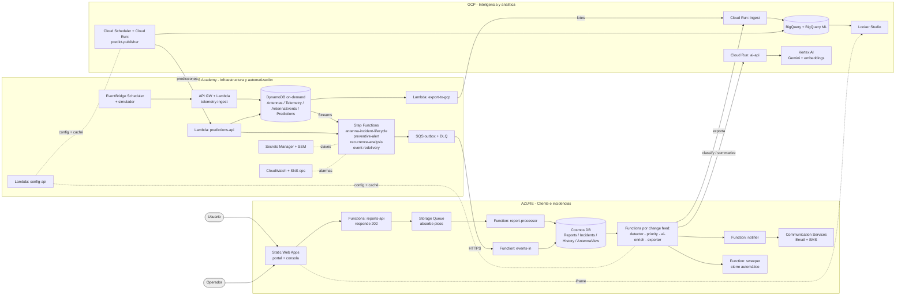
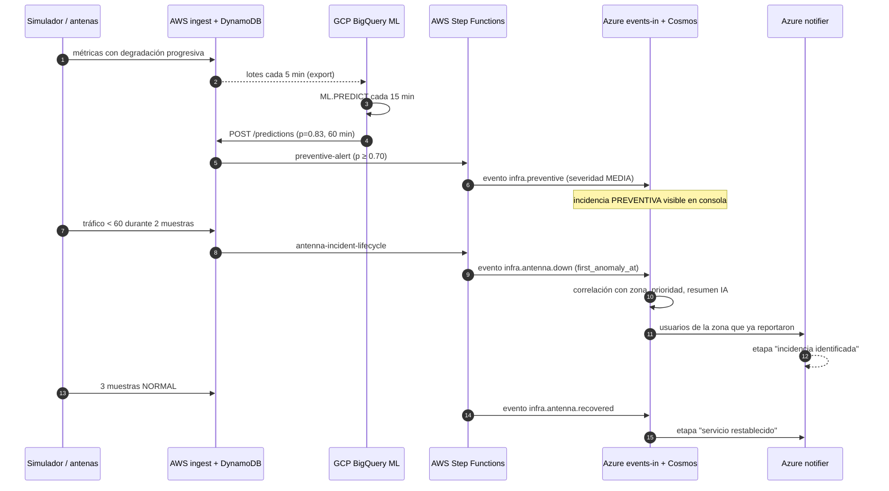
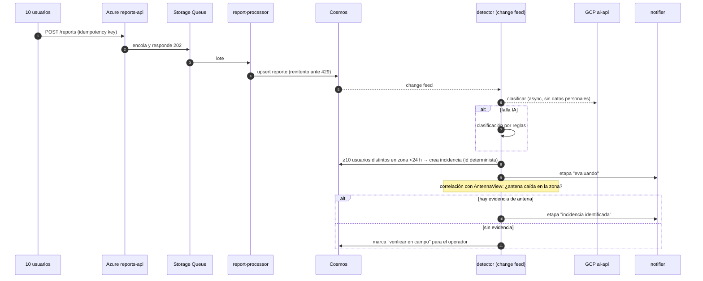
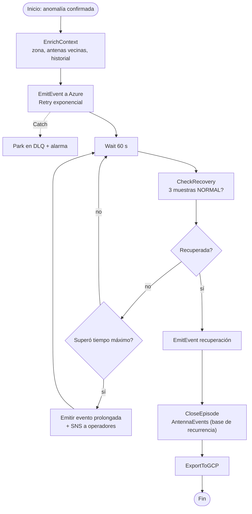
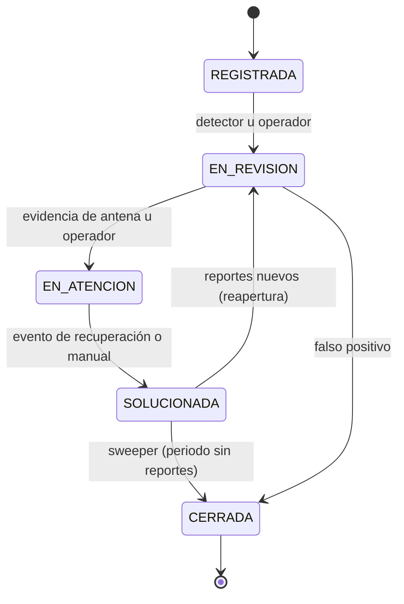

# PulsoRed — Plan integral (v3, alineado con REQUISITOS.md)

> Documento **interno**. No subir al repo de entrega ni a Canvas (el enunciado anula informes). Entregables: **video ≤ 5:00**, **repo GitHub**, **diagrama de arquitectura**.

---

## 1. Qué cambió respecto a las versiones anteriores (y por qué)

Revisé mis dos versiones y la propuesta de tu amigo con un criterio explícito: **la ruta crítica de cada historia de usuario debe vivir dentro de una sola nube**; entre nubes solo eventos asíncronos con degradación definida.

| Decisión | v1 (PLAN) | v2 (REQUISITOS) | **v3 (esta)** | Veredicto |
|---|---|---|---|---|
| Sistema de registro | Todo en AWS; Azure solo réplica + hosting | Reportes/incidencias en Azure | **Reportes/incidencias en Azure; infraestructura en AWS** | v1 era el error: dejaba a Azure sin rol real, sobrecargaba a P1 y la réplica no aportaba función. Tu amigo acertó con la separación por contextos |
| Notificaciones | AWS | **AWS** | **Azure** | **v2 fue un error mío**: creaba la ruta Azure → AWS → usuario y ataba los avisos al Lab. Tu amigo tenía razón |
| Estado de antenas en Azure | — | Consulta síncrona a AWS | **Proyección local alimentada por eventos** | v2 acoplaba la ruta crítica; corregido |
| IA sobre reportes | Síncrona | Síncrona con timeout | **Asíncrona** (change feed) con reglas de respaldo | Un reporte jamás espera a la IA |
| Step Functions | Ciclo de vida de la incidencia colectiva | Ciclo de la antena | **4 máquinas en AWS**, todas en el dominio de infraestructura | Mantengo SF donde su dominio es real y evito que AWS controle paso a paso datos que viven en Azure |
| Predicción de fallas | Mejora | MVP | **MVP, con más IA en GCP** | Es el mejor argumento de IA y GCP es el lugar natural |
| Config/secretos | Secrets + SSM | igual | **+ `GET /config` global** | Un solo origen de umbrales para las 3 nubes |

**Lo que mantengo de tu amigo:** módulos por nube, predicción de fallas, notificaciones en Azure, RF-AWS-12 (reenvío tras fallos). **Lo que añado:** Step Functions con trabajo real, recurrencia, tiempo de detección, picos de reportes, catálogo de zonas único, contratos con idempotencia, simulador con degradación, IA de más tipos.

### Alternativas descartadas (con motivo)

| Alternativa | Motivo |
|---|---|
| Orquestar el ciclo de la incidencia colectiva con Step Functions llamando a Azure en cada paso | Doble acoplamiento (el Lab pasa a ser ruta crítica del cliente). **Plan B** si piden SF en el flujo de usuarios: añadir una 5.ª máquina que solo *observa* la incidencia |
| AWS IoT Core para telemetría | Disponibilidad en el Lab incierta y MQTT no aporta a ~60 antenas; HTTP + SQS basta |
| Timestream / Kinesis / Pub/Sub + Dataflow | Costo por hora/shard o sin necesidad a este volumen |
| Azure Durable Functions | Segundo orquestador sin valor; cambio de estado se resuelve con change feed + temporizador |
| Cosmos *serverless* | No tiene free tier; se usa el free tier provisionado + cola de absorción |
| Service Bus Standard | Cargo fijo mensual; Storage Queues cubre la necesidad |
| Vertex AI AutoML / Bedrock | Costo de entrenamiento / acceso restringido en Academy; BigQuery ML es suficiente y casi gratis |
| Terraform multinube | Credenciales del Lab rotan; overhead sin retorno para 3 personas |

---

## 2. Diseño de la solución

### 2.1 Qué construimos
1. **Portal de usuario** (Azure): reportar incidencias y consultar estado e historial.
2. **Consola de operación** (SPA en Azure): bandeja priorizada, mapa de zonas/antenas, línea de tiempo, riesgo predictivo, resumen de IA, dashboard de analítica incrustado.
3. **Motor de infraestructura** (AWS): telemetría, estados, eventos, automatizaciones.
4. **Motor de inteligencia** (GCP): predicción de fallas, clasificación y resúmenes con IA, histórico y analítica.

### 2.2 Problema del enunciado → solución

| # | Dolor | Solución | Requerimientos |
|---|---|---|---|
| 1 | Portal de incidencias | Formulario idempotente con todos los campos | RF-AZ-01…03 |
| 2 | Consultar/administrar, estados e historial | Estados validados + historial inmutable + consola | RF-AZ-04…06, 19…20 |
| 3 | Aislados que son colectivos | Detector ≥10 usuarios distintos / zona / 24 h | RF-AZ-08…13 |
| 4 | Informar a los afectados | Tres etapas por email/SMS, 1 por usuario | RF-AZ-23…25 |
| 5 | Priorización | Puntaje explicable (§4.5) + sitios críticos por IA | RF-AZ-18 |
| 6 | Zonas/antenas/tipos más frecuentes | BigQuery + Looker | RF-GCP-17…18 |
| 7 | Recurrentes → estructural | `recurrence-analysis` nocturno | RF-AWS-15 |
| 8 | Detectar antes que los usuarios; relacionar usuarios con infraestructura | Telemetría + **predicción** + correlación + métrica de tiempo de detección | RF-AWS-09…14, RF-AZ-14…16, RF-GCP-05…07 |
| 9 | Picos simultáneos sin pérdida | Escritura durable / colas en cada nube + `429` + reintentos | RF-AWS-17…18, RF-AZ-27 |
| 10 | Información histórica | Export idempotente a BigQuery | RF-AZ-32, RF-AWS-19, RF-GCP-01…02 |
| 11 | Umbrales de antena | Clasificador configurable | RF-AWS-04 |
| 12 | Bajo costo, crece con el uso, sin infra encendida | Serverless + free tiers + IA donde aporta | RNF-01…02 |

### 2.3 MVP vs. extras
**MVP (en orden):** catálogo + simulador → telemetría y estado → reportes y estados → detector colectivo → eventos AWS→Azure con outbox → `antenna-incident-lifecycle` → notificaciones → priorización → IA generativa (clasificar/resumir) → predicción de fallas + `preventive-alert` → export a BigQuery + Looker → consola → `recurrence-analysis` → secretos/config/alarmas.

**Extras por valor/esfuerzo:** evaluación del modelo y *backtest* contra fallas reales (alto/bajo) · NL→SQL (alto en pitch / riesgo alto) · tiempo real con SignalR (medio/bajo) · pronóstico por zona (medio/medio) · embeddings (medio/medio) · ARIMA_PLUS (medio/medio) · texto de notificación por IA (bajo/bajo) · reconciliación de antenas (medio/bajo).

---

## 3. Arquitectura multinube

### 3.1 Por qué cada nube (comparativa honesta)

| Necesidad | AWS | GCP | Azure | Elegida |
|---|---|---|---|---|
| Orquestación (rúbrica) | **Step Functions** | Workflows | Durable Functions | AWS |
| Secretos/config (enunciado) | **Secrets Manager / SSM** | Secret Manager | Key Vault | AWS |
| Telemetría y ráfagas | DynamoDB on-demand + Lambda + SQS | Firestore | Cosmos (throughput provisionado en free tier) | AWS (escala elástica sin tarjeta) |
| Documentos del cliente + reacción a cambios | DynamoDB Streams | Firestore triggers | **Cosmos change feed**, free tier 1000 RU/s, respaldo continuo | Azure |
| Correo + SMS con una API | SES + SNS (SMS sujeto a restricciones del Lab) | — | **Communication Services** | Azure |
| Frontend + auth de operadores | S3 + CloudFront + Cognito | Firebase Hosting | **Static Web Apps** (free, auth integrada) | Azure |
| Continuidad si el Lab se apaga | ✗ | ✓ | ✓ | Cliente en Azure |
| ML sobre datos tabulares | SageMaker (caro) | **BigQuery ML** (SQL, sin servidor, capa gratuita) | Azure ML | GCP |
| IA generativa | Bedrock (restringido en Academy) | **Vertex AI Gemini + embeddings** | Azure OpenAI (acceso restringido) | GCP |
| Analítica + BI | Athena + QuickSight (pago) | **BigQuery + Looker Studio gratis** | Synapse | GCP |

### 3.2 Diagrama general

> Para Canvas, redibujar en draw.io/Excalidraw con íconos oficiales de cada nube. Este diagrama es el de trabajo.

### 3.3 Escenario A — predicción → falla → incidencia (ruta proactiva)

### 3.4 Escenario B — ráfaga de reportes → incidencia colectiva

### 3.5 Máquina `antenna-incident-lifecycle`

Otras tres máquinas:
- **`preventive-alert`**: `ValidatePrediction → Choice(p ≥ umbral y horizonte ≤ 24 h) → Choice(¿alerta vigente?) → CreateAlert → EmitEvent`.
- **`recurrence-analysis`** (Scheduler nocturno): `ListAntennas → Map(MaxConcurrency 5) → CountEpisodes(7d/30d) → Choice → EmitStructural(dedupe)`.
- **`event-redelivery`** (Scheduler cada 5 min + manual): `ReadDLQ → Map(EmitEvent) → DeleteIfOk → Choice(¿quedan? → alarma)`.

### 3.6 Estados

---

## 4. Stack y detalles técnicos

### 4.1 Por capa

| Capa | AWS | Azure | GCP |
|---|---|---|---|
| Cómputo | Lambda (Python 3.12), sin VPC | Functions en consumo (Python), sin plan dedicado | Cloud Run functions (Python) |
| API | API Gateway HTTP API | Functions HTTP + CORS al SWA | Cloud Run (HTTPS + API key) |
| Datos | DynamoDB on-demand (PITR) | Cosmos DB free tier (respaldo continuo) | BigQuery (particionado) |
| Mensajería | Streams, SQS + DLQ, SNS | Storage Queue | — (ingesta directa; Pub/Sub solo si hace falta) |
| Automatización | **Step Functions** + EventBridge Scheduler | Change feed + Timer trigger | Cloud Scheduler |
| IA | — (recibe predicciones) | Llama a `ai-api` | BigQuery ML, Vertex AI Gemini/embeddings |
| Frontend / BI | — | Static Web Apps (React + Vite + Tailwind + Leaflet) | Looker Studio |
| Secretos/config | **Secrets Manager + SSM** (fuente única) | Caché de `/config`; claves locales solo para su propio uso | Caché de `/config` |
| Notificaciones | SNS solo para alertas a operadores | **Communication Services** | — |
| Monitoreo | CloudWatch, X-Ray | Application Insights | Cloud Logging/Monitoring |
| IaC | **AWS SAM** con `LabRole` fijo | Azure CLI/Bicep mínimo + GitHub Action de SWA | `gcloud` en script |

Deploy de AWS **manual desde laptop** (las credenciales del Lab rotan cada sesión). Contratos en `/contracts` (`openapi.yaml`, `events/*.json`, `zones.json`).

### 4.2 Modelo de datos

**AWS (DynamoDB):** `Antennas` (estado, `state_since`, `last_seen`, GSI por zona) · `Telemetry` (TTL 7 días) · `AntennaEvents` (antena + `ts`, transiciones; base de recurrencia) · `Predictions` (antena + `valid_until`, TTL) · `Outbox` (SQS).
**Azure (Cosmos, partición `zone_id` para reportes e incidencias):** `Reports` (`user_key`, estado, `incident_id`, `ai{categoría, urgencia, sitio_crítico, fuente}`), `Incidents` (tipo, origen, prioridad, usuarios, `detected_by`, `detection_lag_s`, `first_report_at`, `first_anomaly_at`), `History` (append-only), `Notifications` (id = `incident#user#etapa` → unicidad), `AntennaView` (proyección por zona), `leases` del change feed.
**GCP (BigQuery, `pulsored`):** `telemetry`, `antenna_events`, `reports`, `incidents`, `incident_history`, `predictions`, `rejects`; modelo `failure_model`; vistas `v_zone_ranking`, `v_antenna_recurrence`, `v_type_frequency`, `v_incident_durations`, `v_mttd`, `v_prediction_outcomes`.

### 4.3 Picos sin pérdida (por nube)
- **AWS:** DynamoDB on-demand + Lambda por lotes; API Gateway con límite de tasa y `429/Retry-After`; el simulador reintenta con *jitter*. Verifica la cuota de concurrencia de Lambda del Lab el Día 0: si es baja, el diseño por lotes la tolera.
- **Azure:** Cosmos free tier es throughput **provisionado** (no elástico), por eso `reports-api` solo encola (`202`) y `report-processor` escribe con reintento ante `429`. La cola es el amortiguador.
- **Detección:** el *change feed* procesa en orden por partición y la incidencia se crea con **id determinista** (`zona#inicio_ventana`) → conflicto `409` = ya existe → sin duplicados.
- **IA:** por reporte pero asíncrona y con límite; por incidencia para resúmenes; nunca en la ruta del usuario.

### 4.4 IA (3 pts): qué hace cada pieza y por qué ahí

| Pieza | Dónde | Por qué |
|---|---|---|
| **Predicción de falla** (`BOOSTED_TREE_CLASSIFIER`, etiqueta "falla en ≤ 60 min") con características de tendencia, volatilidad, mínimos, saturaciones y fallas previas | BigQuery ML | Los datos ya están en BigQuery; entrenar y predecir con SQL, sin servidor y casi gratis |
| Clasificación/extracción de reportes (JSON) | Gemini | Texto libre en español; detecta hospital/colegio/industria para la prioridad |
| Resumen, hipótesis de causa y acción recomendada | Gemini | Ahorra tiempo al operador |
| ARIMA_PLUS (anomalías), pronóstico por zona | BigQuery ML | Señal no supervisada y apoyo a decisiones (extra) |
| Embeddings + similitud | Vertex AI + BigQuery | Agrupa reportes con ubicación imprecisa (extra) |
| NL → SQL | Gemini + BigQuery | "Pregúntale a la red" (extra) |

**Honestidad con los datos:** el histórico es **sintético** (mismo generador en simulador y GCP, con degradación lineal previa a la falla). Se reporta precisión/recall sobre datos reservados y **se dice que es sintético** en el pitch; no se vende como si fuera producción.
**Calidad:** esquema validado, tiempo de espera corto, caché, `model_version`, **sin documento ni teléfono en prompts**. Si falla: reglas (`fuente=reglas`).

### 4.5 Priorización (Azure, determinista y explicable)
`score = 40·U + 25·Z + 20·A + 10·D + 5·R`
- **U** `min(1, log10(usuarios)/4)` · **Z** tipo de zona (SALUD/CRITICA 1.0, EDUCATIVA 0.8, INDUSTRIAL 0.7, COMERCIAL 0.5, RESIDENCIAL 0.4; +0.2 si la IA detecta sitio crítico) · **A** evidencia de antena (INHABILITADA 1.0, CAIDA 0.7, SATURADA 0.5, ninguna 0 = "verificar en campo") · **D** `min(1, horas/6)` · **R** `min(1, incidentes_antena_30d/5)`.
Niveles: **CRÍTICA ≥ 75 · ALTA 50–74 · MEDIA 25–49 · BAJA < 25**. Los pesos viven en `/config`. Preventivas y estructurales no notifican a usuarios (no hay usuarios asociados).

### 4.6 Seguridad
Claves entre nubes en **un secreto JSON** de Secrets Manager; umbrales en SSM; `gitleaks` en pre-commit; CORS al dominio del SWA; operadores con la autenticación de Static Web Apps; validación por JSON Schema; los endpoints de GCP exigen API key.

### 4.7 Costos (órdenes de magnitud, a verificar)
| Nube | Estimación |
|---|---|
| AWS | < USD 5 del crédito del Lab (Lambda, DynamoDB, SQS, API GW en centavos; Step Functions < USD 1; Secrets Manager ~USD 0.40/mes) |
| Azure | USD 0 (Functions y Cosmos free tier, SWA Free); Storage Queue y correo en centavos, cubiertos por el crédito de estudiante |
| GCP | USD 0–2 (BigQuery y Cloud Run en capa gratuita; Gemini Flash en centavos con el crédito de prueba) |
Guardarraíles: simulador apagado fuera de pruebas; revisar crédito del Lab cada día; alerta de presupuesto en GCP; ningún servicio con costo por hora (NAT, Kinesis, RDS, OpenSearch, EC2).

---

## 5. Equipo y trabajo en paralelo

| | **P1 — AWS** | **P2 — Azure** | **P3 — GCP + Consola** |
|---|---|---|---|
| Construye | Tablas, `telemetry-ingest`, simulador, estados/eventos, outbox + DLQ, **4 máquinas Step Functions**, `predictions-api`, `export-to-gcp`, `config-api`, secretos, alarmas; `e2e` y carga | `reports-api`, cola, `report-processor`, detector, prioridad, `events-in`, `notifier` + ACS, `sweeper`, exportador, portal de usuario, respaldo | Datos y vistas en BigQuery, histórico sintético, modelo BQML, `predict-publisher`, `ingest`, `ai-api` (Gemini), Looker, **consola SPA**, diagrama y video |
| Extras | Reconciliación, `Map` más fino | SignalR, texto IA, OTP | NL→SQL, embeddings, ARIMA, pronóstico |
| Revisa a | P2 (contrato de eventos) | P3 (contrato de IA) | P1 (contrato de predicciones) |

Reglas: contratos y mocks el día 0; PR con 1 revisión; *feature freeze* 24 h antes; daily de 10 min; quien termina antes desbloquea la ruta crítica.

---

## 6. Roadmap (7 días; en 48 h, comprimir F0–F1 a 6 h, F2–F3 a 20 h, F4 a 12 h, F5 a 10 h y recortar los extras)

| Fase | Días | Trabajo | Hito |
|---|---|---|---|
| **F0 · Verificación** | 1 | Humo en las 3 nubes (§9), contratos (`openapi`, eventos, `zones.json`), repos, secretos, **mocks de las 3 integraciones** | **M0**: "hola mundo" en cada nube + contratos firmados |
| **F1 · Cimientos** | 2–3 | P1: tablas, ingesta, simulador, estados/eventos. P2: `reports-api`, cola, Cosmos, portal. P3: BigQuery, histórico sintético, `ingest`, esqueleto de consola | **M1**: reporte web en Cosmos; métricas en DynamoDB y BigQuery |
| **F2 · Ruta crítica** | 3–4 | P1: `antenna-incident-lifecycle`, outbox + DLQ, `config-api`. P2: detector, `events-in`, AntennaView, prioridad, notifier. P3: `ai-api` + clasificación, BQML v1 | **M2**: 10 reportes → incidencia → correo · antena cae → evento llega a Azure |
| **F3 · Inteligencia y cierre** | 4–5 | P1: `preventive-alert`, `recurrence-analysis`, `event-redelivery`, predicciones. P2: sweeper, reapertura, exportador, resumen IA. P3: `predict-publisher`, vistas, Looker, consola completa | **M3 (MVP)**: tres escenarios completos de punta a punta |
| **F4 · Resiliencia y pruebas** | 5–6 | Carga, caos (AWS/GCP caídos), DLQ, restauración, ajuste de costos; 1–2 extras | **M4**: batería §7 en verde · **FEATURE FREEZE** |
| **F5 · Entrega** | 6–7 | Diagrama final, README mínimo, guion, **2 tomas de video**, Canvas | **M5**: video ≤ 4:45 + repo + diagrama entregados con margen |

**Ruta crítica:** contratos → simulador y estados → outbox → `events-in` → detector → notifier. Todo lo demás puede degradarse.

---

## 7. Validación

### 7.1 Reglas (unitarias)
| Prueba | Esperado |
|---|---|
| Tráfico 0, 0.1, 59.9, 60, 129, 129.1 | INHABILITADA, CAIDA, CAIDA, NORMAL, NORMAL, SATURADA |
| 9 usuarios · 10 reportes de 1 usuario · 10 usuarios en 2 zonas | Sin incidencia |
| 10 usuarios en 23 h 59 min · 10.º a las 24 h 01 min | Incidencia · sin incidencia (ventana deslizante) |
| 11.º usuario con incidencia abierta | Se agrega; **no** crea otra |
| 10 reportes en paralelo | **Exactamente 1** incidencia (`409` en el resto) |
| Anomalía de 1 muestra · de 2 · recuperación de 2 · de 3 | Sin evento · evento · sin recuperar · recuperada |
| Predicción p=0.69 · p=0.70 con horizonte 25 h · p=0.85 con 6 h | Sin alerta · sin alerta · alerta |
| Reintento de notificación | 1 mensaje por usuario por etapa |
| Prioridad | Salud + 5 000 usuarios + antena caída > residencial + 12 usuarios |

### 7.2 Integración (`e2e.sh`, P1)
1. Simular degradación → predicción en GCP → alerta preventiva visible en Azure (INT-03/01).
2. Caída de antena → evento en Azure ≤ 60 s (INT-01).
3. 10 reportes → incidencia con `ai_source=gemini` (INT-04) y correo recibido.
4. Recuperación → "restablecido" enviado.
5. Fila en BigQuery de reportes, incidencias y eventos (INT-02/05).
6. `GET /config` leído por Azure y GCP (INT-06).

### 7.3 Persistencia, disponibilidad y degradación
| Prueba | Esperado |
|---|---|
| Restaurar DynamoDB con PITR y Cosmos desde respaldo | Datos íntegros |
| **Apagar AWS** (deshabilitar API stage) | Portal sigue recibiendo reportes, detectando colectivas y notificando; la consola muestra "infra desactualizada" |
| **Apagar GCP** (invalidar clave) | Clasificación por reglas, sin predicciones/resumen; el flujo completa |
| **Azure inaccesible** | Eventos van a DLQ; al volver, `event-redelivery` los reenvía sin duplicados |
| Reenviar el mismo POST 5 veces | 1 reporte |
| Forzar fallo del notifier | Reintentos, sin duplicar |

### 7.4 Carga
Script (k6/asyncio) con **2 000 reportes en 60 s** a 10 zonas + 60 antenas en modo apagón. Criterios: **0 pérdidas** (almacenados = aceptados con `202`), p95 de `POST` < 1 s, colas y DLQ vacías al final, 1 incidencia por zona afectada, consumo del Lab y de GCP dentro de lo previsto.

### 7.5 Predicción
Precision/recall sobre datos reservados; en vivo, cuántas predicciones precedieron a una caída real (`v_prediction_outcomes`). Se reporta con la advertencia de datos sintéticos.

### 7.6 Ensayo general
Dos ensayos cronometrados con el Lab recién iniciado (la sesión dura 4 h: iniciarla **antes** de grabar).

---

## 8. Rúbrica, pitch y entrega

| Criterio | Evidencia |
|---|---|
| Problemas (0–3) | 12/12 (§2.2), los tres escenarios de demo |
| Persistencia y HA (0–2) | PITR + respaldo continuo + copias entre nubes + DLQ + demo "apagar AWS" |
| Step Functions (0–2) | 4 máquinas con `Choice`, `Wait`, `Map`, `Retry/Catch`; la ruta proactiva pasa por ellas |
| 3 nubes (0–3) | Contextos autónomos; el flujo real cruza las tres |
| Arquitectura (0–3) | Principio de ruta crítica, contratos, idempotencia, degradación |
| Serverless (0–2) | Slide "lo que NO usamos" |
| IA (0–3) | Predicción BQML + Gemini en el flujo + fallback (+ NL→SQL si hay tiempo) |
| Pitch (0–2) | Guion cronometrado |

**Escenarios de demo:** (1) antena que se degrada → predicción → alerta preventiva → caída → incidencia → "restablecido"; (2) ráfaga de 10 reportes → colectiva → correos → priorización; (3) Looker + recurrencia estructural; (4) 20 s de resiliencia: apagar AWS y seguir reportando.

**Guion (corte duro 4:45, nunca > 5:00):** 0:00 gancho (el cliente se entera antes que la red) · 0:30 arquitectura y "por qué cada nube" · 1:15 demo 1 y 2 · 3:15 analítica e IA · 3:45 resiliencia y costo ≈ USD 0 · 4:15 rúbrica en 4 viñetas · 4:45 fin.
**Canvas:** video · repo (README de ≤ 1 pantalla, sin informe, sin secretos, sin estos planes) · diagrama.

---

## 9. Verificación del Día 0 y riesgos

**No pude comprobar el Lab real; esto hay que verificarlo en la primera hora.**
- **AWS Academy:** región y `LabRole`; Step Functions con Lambda + DynamoDB; Streams → Lambda; SQS; EventBridge Scheduler; Secrets Manager y SSM; cuota de concurrencia de Lambda; crédito y duración de sesión.
- **Azure:** suscripción de estudiante, regiones permitidas, Cosmos free tier, Functions en consumo (Python), Communication Services (correo con dominio administrado; **SMS: disponibilidad y número según país**), Static Web Apps.
- **GCP:** crédito/facturación, Vertex AI, BigQuery ML, Cloud Run, Looker Studio.

| Riesgo | Mitigación |
|---|---|
| SMS no disponible en ninguna nube | Interfaz de canal con degradación a correo; plan B: SMS simulado declarado como tal o prueba de un proveedor externo |
| Límites del correo administrado de Azure | Notifier con tasa limitada; pocos destinatarios verificados en la demo |
| Lab se apaga o se acaba el crédito | Cliente en Azure y GCP independientes; video grabado con margen; script `seed+demo` que reconstruye AWS |
| Cosmos free tier (1000 RU/s) se satura | Cola de absorción, partición por zona, 400 RU/s compartidos, reintento ante `429` |
| Dependencias cruzadas frágiles | Mocks por contrato desde el día 0 y `e2e` desde F2 |
| Modelo con pocos datos | Histórico sintético con patrón claro; mostrar métricas honestas |
| Alcance excesivo | MVP congelado en F3; recortar extras de IA antes que la ruta crítica |
| Credenciales del Lab rotan | Deploy manual; secretos en Secrets Manager |
