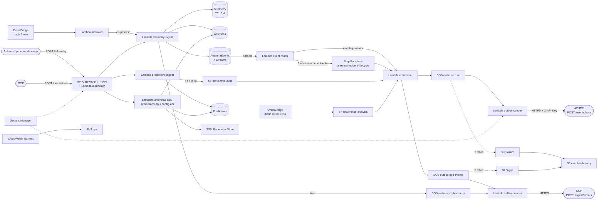

# Módulo AWS — Infraestructura y automatización (documento pilar)

> **Este es el documento desde el que se construye todo el módulo AWS.** Si algo en `docs/global/` lo contradice, **manda este archivo** (y avisa para corregir el otro).
> Interno: **borrar `docs/` del repo antes de entregar** (el enunciado anula a quien entregue un "informe").

---

## 0. Cómo usar este documento

1. Lee §1–§3 para entender el módulo y sus reglas.
2. Construye siguiendo el plan de §16 (tareas con dependencias y criterio de "hecho").
3. Los contratos exactos están en `contracts/` (`openapi-aws.yaml`, `events/*.json`, `zones.json`, `enums.json`). **El código se valida contra ellos.**
4. Lo no verificado está marcado **[VERIFICAR]** y se resuelve en el Día 0 (§18).

### Decisiones adoptadas ("vamos con lo que tenemos")
Estas son las decisiones que asumo para los puntos que el equipo no cerró. Cámbialas solo si el equipo lo decide.

| Decisión | Valor adoptado | Efecto en AWS |
|---|---|---|
| IA generativa (Gemini) | Sí | Ninguno directo (es Azure ↔ GCP) |
| Reportes relacionados | Misma zona + tiempo (tipo configurable) | Ninguno (es Azure) |
| Tipos de evento hacia Azure | **7** (FALLA, SATURACION, DEGRADACION, RECUPERACION, PREVENTIVA, ESTRUCTURAL, PROLONGADA) | Emito los 7 |
| Recurrencia | **AWS la detecta y emite ESTRUCTURAL**; GCP la analiza | `recurrence-analysis` es mío |
| Umbral de envío de predicciones | GCP envía p ≥ 0.50; **AWS decide alerta** con p ≥ 0.70 y horizonte ≤ 24 h | Lógica de alerta en AWS |
| Un mismo JSON de evento para Azure y GCP | Sí (`type: antenna.event`) | Una sola cola de formato, dos destinos |

---

## 1. Alcance

AWS es el **plano de infraestructura y automatización**: recibe la telemetría de las antenas, decide su estado, detecta episodios de falla, emite eventos a Azure y GCP sin perderlos, recibe las predicciones de GCP y genera alertas preventivas, detecta recurrencia, y es la fuente única de configuración y secretos.

**No hago:** reportes de usuarios, incidencias colectivas, priorización, notificaciones a usuarios (Azure) · modelos ni analítica (GCP).

**Principio:** nada de lo mío depende de Azure ni GCP para funcionar. Si ellos caen, **acumulo y reintento**; si yo caigo, ellos siguen.

### 1.1 Requerimientos AWS (numeración `RF-AWS-xx`)
| ID | Resumen | Componente (§2) | P |
|---|---|---|---|
| 01 | Recibir métricas (lote, API autenticada) | `telemetry-ingest`, `POST /telemetry` | M |
| 02 | Identificar antena ↔ zona (catálogo único) | tablas `Zones`, `Antennas` | M |
| 03 | Validar métricas y registrar rechazos | `telemetry-ingest`, tabla `Rejects` | M |
| 04 | Clasificar estado con umbrales configurables | `common/classify.py` + SSM | M |
| 05 | Almacenar métricas con TTL | tabla `Telemetry` | M |
| 06 | Registrar cambios de estado | tabla `AntennaEvents` | M |
| 07 | Consultar estado/métricas por antena y zona | `antennas-api` | M |
| 08 | Simulador con escenarios (incl. degradación previa a falla) | `simulator`, `simulator-control` | M |
| 09 | Detectar anomalías con anti-ruido, intermitencia, saturación sostenida | `telemetry-ingest` (máquina de confirmación) | M |
| 10 | Severidad por evento | `common/events.py` | M |
| 11 | Emitir eventos a Azure con sobre común | `emit-event` + colas outbox | M |
| 12 | Outbox durable, reintentos, DLQ, reenvío | SQS + `outbox-sender` + SF `event-redelivery` | M |
| 13 | SF `antenna-incident-lifecycle` | Step Functions | M |
| 14 | SF `preventive-alert` | Step Functions | M |
| 15 | SF `recurrence-analysis` | Step Functions | M |
| 16 | SF `event-redelivery` | Step Functions | M |
| 17 | Procesamiento concurrente por lotes | `telemetry-ingest` | M |
| 18 | Adaptación a picos sin pérdida | API GW, DynamoDB on-demand, SQS | M |
| 19 | Exportar métricas y eventos a GCP | outbox GCP | M |
| 20 | Recibir y almacenar predicciones | `predictions-ingest` | M |
| 21 | Alertas preventivas | SF `preventive-alert` | M |
| 22 | Consultar predicciones vigentes | `predictions-api` | M |
| 23 | Secrets Manager + SSM | §9 | M |
| 24 | `GET /config` global | `config-api` | M |
| 25 | Alarmas, tablero, SNS a operadores | §10 | M |

**Equivalencia con los IDs del README del amigo (AWS):** 01→01 · 02→02 · 03→04 · 04→04 · 05→05 · 06→06 · 07→09,10 · 08→11 · 09→07 · 10→17 · 11→18 · 12→12 · 13→20 · 14→21 · 15→22.

---

## 2. Arquitectura



### 2.1 Lambdas (Python 3.12, arm64, **sin VPC**, rol `LabRole`)
| Función | Disparador | Qué hace |
|---|---|---|
| `authorizer` | API Gateway | Valida `X-API-Key` contra el secreto y devuelve el *caller* (caché 5 min) |
| `telemetry-ingest` | `POST /telemetry` y simulador | Valida, clasifica, guarda, ejecuta la máquina de confirmación, escribe eventos, encola telemetría para GCP |
| `antennas-api` | `GET /antennas…` | Lee estado y métricas; añade predicción vigente |
| `predictions-ingest` | `POST /predictions` | Valida, guarda y arranca `preventive-alert` si p ≥ 0.70 |
| `predictions-api` | `GET /predictions` | Predicciones vigentes |
| `config-api` | `GET /config` | Devuelve SSM versionado (sin secretos) |
| `simulator` | EventBridge cada 1 min | Genera 60 muestras y las procesa |
| `simulator-control` | `/simulator/*` | Start/stop/escenarios (clave de operador) |
| `event-router` | Stream de `AntennaEvents` | Arranca SF del episodio o publica eventos posteriores |
| `emit-event` | SF y router | Construye el sobre con `event_id` determinista y publica en las colas |
| `enrich-context` | SF | Zona, antenas vecinas, historial |
| `check-recovery` | SF | ¿La antena volvió a NORMAL? ¿Cuánto lleva el episodio? |
| `check-preventive` | SF | ¿Elegible? ¿Ya hay alerta vigente? |
| `list-antennas` / `count-episodes` | SF recurrencia | Lista y cuenta episodios 7 d / 30 d |
| `outbox-sender` | SQS (3 colas) | Hace el `POST` a Azure/GCP; el destino se deduce de la cola |

Código común en una capa `common/`: `config.py`, `secrets.py`, `envelope.py`, `classify.py`, `events.py`, `ddb.py`, `validators.py`, `logging.py`.

### 2.2 Colas SQS
`outbox-azure`, `outbox-gcp-events`, `outbox-gcp-telemetry`, cada una con su **DLQ** (`*-dlq`). Visibilidad 360 s, `maxReceiveCount` 5, retención 14 días. **Una cola por destino**: si Azure cae, GCP sigue recibiendo.

---

## 3. Reglas de dominio

### 3.1 Clasificación (RF-AWS-04) — **0 se evalúa primero**
```python
def classify(x):                      # x en GB/min
    if x == 0:   return "INHABILITADA"
    if x < 60:   return "CAIDA"       # 0 < x < 60
    if x <= 129: return "NORMAL"      # 60 <= x <= 129
    return "SATURADA"                 # x > 129
```
Pruebas obligatorias: `0, 0.1, 59.9, 60, 129, 129.1` → INHABILITADA, CAIDA, CAIDA, NORMAL, NORMAL, SATURADA.

### 3.2 Máquina de confirmación por antena (RF-AWS-09)
Estado guardado en `Antennas`: `state` (confirmado), `candidate_state`, `candidate_count`, `candidate_since`, `last_ts`.
Por cada muestra con estado crudo `r` (en orden de `ts`; se ignoran muestras con `ts ≤ last_ts`):
1. Si `r == state`: se limpia el candidato.
2. Si no: si `r == candidate_state` → `candidate_count++`; si no → `candidate_state = r`, `candidate_count = 1`, `candidate_since = ts`.
3. Confirmación cuando `candidate_count ≥ N(r)`: **N = 2** para CAIDA/INHABILITADA, **N = 3** para NORMAL (recuperación), **N = 5** para SATURADA (saturación sostenida ≥ 5 min).
4. Al confirmar: `previous = state; state = r; state_since = ts`.

### 3.3 Episodios y eventos
- **Episodio:** de la primera anomalía confirmada hasta la recuperación confirmada. `episode_id = "EP-<antenna_id>-<epoch de first_anomaly_at>"`. `first_anomaly_at = candidate_since` (primera muestra anómala, antes de confirmar) → base del tiempo de detección.
- Eventos que escribe **`telemetry-ingest`** (hechos de detección):

| Transición confirmada | `event_type` | Severidad |
|---|---|---|
| NORMAL → INHABILITADA | FALLA | CRITICA |
| NORMAL → CAIDA | FALLA | ALTA |
| NORMAL → SATURADA | SATURACION | MEDIA |
| anómalo → otro anómalo (empeora/cambia), mismo episodio | FALLA o SATURACION según el nuevo estado | por nuevo estado |
| anómalo → NORMAL | RECUPERACION | INFO |

- **Intermitencia (DEGRADACION, MEDIA):** ≥ 4 transiciones crudas NORMAL↔anómalo en 30 min (se guardan las últimas 10 marcas en `Antennas.transitions`); no más de una por antena cada 30 min.
- Eventos que producen las **máquinas de estado:** PROLONGADA (episodio sin recuperar tras `PROLONGED_AFTER_MIN`, severidad = la del episodio subida un nivel, tope CRITICA), PREVENTIVA (MEDIA; ALTA si p ≥ 0.90), ESTRUCTURAL (ALTA).
- **`event_id` determinista:** `uuid5(NAMESPACE, f"{antenna_id}|{event_type}|{new_state}|{ts}")`. Reintentar nunca crea un id nuevo → los receptores deduplican.

### 3.4 Recurrencia (RF-AWS-15)
Episodios = `episode_id` distintos con evento FALLA/SATURACION. **ESTRUCTURAL** si `episodios_7d ≥ 3` o `episodios_30d ≥ 5`. No se vuelve a emitir mientras `Antennas.structural_until` esté vigente (hoy + `STRUCTURAL_REEMIT_DAYS`, 7).

### 3.5 Alerta preventiva (RF-AWS-21)
Se emite si `probability ≥ PRED_ALERT_MIN (0.70)` **y** `horizon_minutes ≤ PRED_HORIZON_MAX_MIN (1440)` **y** `valid_until > ahora` **y** la antena no tiene `preventive_until` vigente (= `valid_until` de la alerta anterior). Pre-filtro en `predictions-ingest` para no gastar ejecuciones de SF en lo que no cumple.

---

## 4. API que AWS expone

Contrato completo: `contracts/openapi-aws.yaml`. Resumen:

| Ruta | Quién | Notas |
|---|---|---|
| `POST /telemetry` | antenas, pruebas de carga | `telemetry.batch`, ≤ 500 muestras, `202` con `{accepted, duplicates, rejected[]}` |
| `GET /antennas`, `/antennas/{id}`, `/antennas/{id}/metrics` | Azure, consola | estado actual, última métrica, predicción vigente |
| `POST /predictions` | **GCP** | `prediction.batch` |
| `GET /predictions` | GCP, Azure | vigentes, por probabilidad desc |
| `GET /config` | Azure, GCP | versionado; **sin secretos** |
| `POST /simulator/start·stop·scenario`, `GET /simulator/status` | operador | |
| `GET /health` | cualquiera | sin clave |

**Autenticación:** `X-API-Key`; `authorizer` Lambda tipo REQUEST (formato 2.0, respuesta simple, TTL 300 s). Una clave por llamante (`telemetry`, `gcp`, `azure`, `operator`) y permisos por ruta:

| Clave | Rutas permitidas |
|---|---|
| `telemetry` | `POST /telemetry` |
| `gcp` | `POST /predictions`, `GET /predictions`, `GET /config`, `GET /antennas*` |
| `azure` | `GET /antennas*`, `GET /predictions`, `GET /config` |
| `operator` | todo, incluido `/simulator/*` |

**Códigos:** `202` aceptado (con rechazos parciales posibles) · `400` inválido (**no reintentar**) · `401` · `429` (backoff) · `5xx` (reintentar). *El límite de tasa lo da API Gateway (`429`); `Retry-After` solo lo añade la Lambda cuando DynamoDB limita.*

---

## 5. Modelo de datos (DynamoDB, todo *on-demand*)

| Tabla | PK / SK | Atributos clave | Índices / TTL |
|---|---|---|---|
| `Zones` | `zone_id` | name, type, centroid, critical_sites | — |
| `Antennas` | `antenna_id` | zone_id, lat, lng, `state`, `state_since`, `last_ts`, `last_gb_per_min`, `candidate_*`, `transitions[]`, `episode_id`, `episode_started_at`, `first_anomaly_at`, `preventive_until`, `structural_until` | GSI `zone-index` (`zone_id`) |
| `Telemetry` | `antenna_id` / `ts` | gb_per_min, state | **TTL 3 días** (`expire_at`) |
| `AntennaEvents` | `antenna_id` / `ts#event_id` | event_id, episode_id, event_type, severity, previous_state, new_state, gb_per_min, first_anomaly_at, `starts_episode`, `published_at` | **Streams** (NEW_IMAGE); sin TTL (base de recurrencia) |
| `Predictions` | `antenna_id` (última por antena) | probability, predicted_state, horizon_minutes, valid_until, generated_at, model_version, alert_status | GSI `zone-index`; TTL 7 días |
| `Rejects` | `day` / `ts#uuid` | origen, índice, motivo, fila original | TTL 7 días |
| `Control` | `key` | `simulator` (activo, escenarios, auto) | — |

**Idempotencia:** `Telemetry` por clave `(antenna_id, ts)` (reenvío = misma fila); `Predictions` solo se reemplaza si `generated_at` es más nuevo; `AntennaEvents.published_at` con escritura condicional; los eventos salientes con `event_id` determinista.
**Escritura de estado:** por antena, `UpdateItem` con `ConditionExpression last_ts = :viejo` (bloqueo optimista; reintento una vez). Los cambios de estado confirmados usan `TransactWriteItems` (`Antennas` + `AntennaEvents`) para que no haya evento sin estado ni al revés.

---

## 6. Flujos

### 6.1 Telemetría → estado → evento
```mermaid
sequenceDiagram
  autonumber
  participant S as Simulador o antenas
  participant I as telemetry-ingest
  participant D as DynamoDB
  participant R as event-router
  participant F as SF lifecycle
  participant E as emit-event
  participant Q as SQS outbox
  participant X as Azure / GCP

  S->>I: lote de muestras
  I->>I: validar, clasificar, máquina de confirmación
  I->>D: Telemetry (batch) + Antennas (optimista)
  I->>D: si confirma: Transact(Antennas + AntennaEvents)
  I->>Q: telemetría -> outbox-gcp-telemetry
  D-->>R: Stream
  alt primer evento del episodio
    R->>F: StartExecution(name = episode_id)
    F->>E: publicar FALLA/SATURACION
  else evento posterior (empeora, recuperación)
    R->>E: publicar directo
  end
  E->>Q: outbox-azure + outbox-gcp-events
  Q->>X: POST con X-API-Key (reintentos; 5 fallos -> DLQ)
```

### 6.2 Outbox (RF-AWS-12)
- `outbox-sender` lee de SQS (`ReportBatchItemFailures`), hace `POST` con timeout 10 s.
- `2xx` → borrar. `5xx`/timeout/`429` → fallo parcial con **espera creciente** (`visibility = min(900, 30·2^(recibidos−1))` s). `4xx` ≠ 429 → es un error permanente: se envía a la DLQ y se registra (no se reintenta).
- **Telemetría a GCP:** ventana de agrupación de 300 s en el *event source mapping*: varios mensajes de 1 min se combinan en un solo `POST` (≈ 300 muestras, ~45 KB, bajo el límite de 256 KB de SQS).
- Con la DLQ no vacía: alarma → `event-redelivery` (§7.4).

### 6.3 Predicciones
`POST /predictions` → validar sobre y cada predicción (antena existe, `0 ≤ p ≤ 1`, `horizonte > 0`, `valid_until > ahora`, estado ∈ {CAIDA, INHABILITADA, SATURADA}) → *upsert* en `Predictions` → si cumple la regla de alerta (§3.5), `StartExecution(preventive-alert)` con nombre `<antena>-<epoch de generated_at>` (ignorar `ExecutionAlreadyExists`) → `202 {accepted, duplicates, rejected[]}`.

---

## 7. Step Functions (Standard)

Todos los `Wait` y umbrales salen de `/config` (modo demo: esperas de 15–20 s).

### 7.1 `antenna-incident-lifecycle` (RF-AWS-13)
**Entrada:** `{event_id, antenna_id, zone_id, episode_id, event_type, severity, new_state, gb_per_min, first_anomaly_at}` · **Nombre de ejecución:** `episode_id`.
| # | Estado | Recurso | Detalle |
|---|---|---|---|
| 1 | `EnrichContext` | Lambda | zona, antenas vecinas, nº de episodios en 30 d |
| 2 | `PublishFirstEvent` | Lambda `emit-event` | `Retry` 3× exponencial; `Catch` → `NotifyOps` |
| 3 | `Wait` | `CHECK_INTERVAL_S` (60) | |
| 4 | `CheckRecovery` | Lambda | devuelve `{recovered, elapsed_min, state}` |
| 5 | `Recovered?` | Choice | sí → 8 |
| 6 | `ProlongedOrTooLong?` | Choice | `elapsed ≥ PROLONGED_AFTER_MIN` y sin escalar → 7; `elapsed ≥ MAX_EPISODE_HOURS` → `NotifyOps` y fin; si no → 3 |
| 7 | `EmitProlonged` | `emit-event` + SNS | evento PROLONGADA + aviso a operadores → 3 |
| 8 | `EnsureRecoveryPublished` | `emit-event` | **auto-reparación:** publica RECUPERACION si el router no lo hizo |
| 9 | `CloseEpisode` | DynamoDB `UpdateItem` directo | limpia `episode_id` de `Antennas` |
| 10 | `Succeed` | | |
Captura general: `NotifyOps` (SNS directo) → `Fail`. Límite de historial: 1 iteración/min durante 12 h ≈ 720 vueltas, dentro del tope de 25 000 eventos.

### 7.2 `preventive-alert` (RF-AWS-14, 21)
`ValidatePrediction` (Choice: p ≥ umbral, horizonte ≤ 24 h, `valid_until > ahora`) → `CheckPreventive` (Lambda: ¿alerta vigente?) → Choice → `RegisterAlert` (DynamoDB: `preventive_until`, `alert_status`) → `EmitPreventive` (`emit-event`) → fin. Rutas de descarte terminan en `Succeed` con motivo.

### 7.3 `recurrence-analysis` (RF-AWS-15)
Disparo: EventBridge diario, 02:00 hora de Lima (07:00 UTC) y manual. `ListAntennas` → **`Map`** (`MaxConcurrency` 5) → `CountEpisodes` → Choice (§3.4) → `EmitStructural` + marcar `structural_until` → `Succeed`. Entrada opcional `{episodes_7d_min, episodes_30d_min}` para bajar umbrales en la demo.

### 7.4 `event-redelivery` (RF-AWS-12, 16)
Disparo: alarma "DLQ > 0" (regla de EventBridge), manual y, como respaldo, cada hora.
`Wait 300 s` (dar tiempo al receptor) → `GetDLQDepth` (SQS directo) → Choice → `StartMessageMoveTask` (SDK SQS) → `Wait 60 s` → `GetDLQDepth` → Choice: ¿quedan y intentos < 3? → bucle; si no → SNS a operadores. **[VERIFICAR]** que `LabRole` permita `StartMessageMoveTask`; plan B: Lambda que mueve los mensajes.

---

## 8. Simulador (RF-AWS-08)

- Se ejecuta cada minuto (EventBridge). Si `Control.simulator.active` es falso, termina al instante (costo ~0).
- **Base:** `N(95, 8)` recortado a `[65, 125]`. **Estados anómalos:** CAIDA ~ U(25, 55) · INHABILITADA = 0 exacto · SATURADA ~ U(135, 170), con ruido `N(0, 3)`.
- **Escenarios** (`POST /simulator/scenario`): `FALLA_ABRUPTA` · `DEGRADACION` (rampa lineal de `ramp_minutes` hacia el estado objetivo, `hold_minutes` sostenido, luego recuperación `ABRUPTA` o `GRADUAL` de 10 min) · `SATURACION` · `APAGON_ZONA` (todas las antenas de la zona a 0) · `INTERMITENTE` (alterna caída/normal cada 1–2 min) · `NORMAL` (cancela).
- **Modo automático:** probabilidad por antena y día `episode_rate_per_antenna_per_day` (0.10); ~80 % de los episodios con **rampa** de 30–90 min y ~20 % abruptos.
- **Firma compartida con GCP:** `seed_history.py` de GCP usa **la misma distribución y proporciones** para que el modelo entrenado reconozca lo que genera el simulador. Cualquier cambio aquí se avisa allá.
- **Modo demo:** `ramp_minutes` de 3–5 en vez de 30–90.

---

## 9. Configuración y secretos (RF-AWS-23, 24)

**SSM Parameter Store** (`/pulsored/config/…`, tipo String; expuestos por `GET /config`):
`THRESHOLD_DOWN=60` · `THRESHOLD_SATURATED=129` · `CONFIRM_SAMPLES=2` · `CONFIRM_SAMPLES_SATURATED=5` · `RECOVERY_SAMPLES=3` · `FLAP_TRANSITIONS=4` · `FLAP_WINDOW_MIN=30` · `PROLONGED_AFTER_MIN=30` · `CHECK_INTERVAL_S=60` · `MAX_EPISODE_HOURS=12` · `PRED_SEND_MIN=0.50` · `PRED_ALERT_MIN=0.70` · `PRED_HORIZON_MAX_MIN=1440` · `PRED_HORIZON_MIN=60` · `RECURRENCE_7D=3` · `RECURRENCE_30D=5` · `STRUCTURAL_REEMIT_DAYS=7` · `TELEMETRY_TTL_DAYS=3` · `DEMO_MODE=false` · `ZONES_VERSION=1.0.0`.
`config_version` = hash SHA-256 (8 caracteres) del conjunto; las Lambdas cachean 60 s.

**Endpoints** (no secretos): `/pulsored/endpoints/azure` y `/pulsored/endpoints/gcp` (URL base). Cambiar de simulado a real = cambiar este valor.

**Secrets Manager — un solo secreto `pulsored/secrets`** (JSON):
```json
{ "inbound":  { "telemetry": "...", "gcp": "...", "azure": "...", "operator": "..." },
  "outbound": { "azure_api_key": "...", "gcp_api_key": "..." } }
```
`inbound` = claves que **otros usan para llamarme** (las genero yo y se las doy); `outbound` = claves que **yo uso para llamarlos** (me las dan). Nunca en el repo ni en `/config`. Un solo secreto minimiza el costo (≈ USD 0.40/mes).

---

## 10. Observabilidad (RF-AWS-25)
- **Logs JSON** con `correlation_id`, `antenna_id`, `episode_id`, `event_id`.
- **Alarmas** (→ SNS `pulsored-ops`, suscribir correos del equipo y confirmar): errores de Lambda ≥ 1 en `telemetry-ingest`/`emit-event`/`outbox-sender`; **DLQ > 0** (×2); `ExecutionsFailed ≥ 1` por máquina; 5xx de API Gateway ≥ 5 en 5 min; antigüedad del mensaje más viejo de `outbox-*` > 10 min.
- **Tablero** de CloudWatch: muestras/min, antenas por estado, eventos emitidos, profundidad de colas y DLQ, ejecuciones de SF, errores. X-Ray activo si el Lab lo permite (opcional).

## 11. Escalabilidad y picos (RF-AWS-17, 18)
Lote ≤ 500 muestras por llamada; `BatchGetItem`/`BatchWriteItem`; DynamoDB *on-demand*; SQS absorbe lo que Azure/GCP no puedan recibir; API Gateway con *throttling* (`rate` 100, `burst` 200 [VERIFICAR]); `telemetry-ingest` devuelve `429` + `Retry-After` si DynamoDB limita. **Prueba de carga:** apagón de las 60 antenas + 1 000 muestras por minuto sin pérdida. **[VERIFICAR]** la cuota de concurrencia de Lambda del Lab: si es baja, el diseño por lotes la tolera.

## 12. Seguridad
Claves por llamante; permisos por ruta; CORS restringido; validación por JSON Schema; sin datos personales (AWS no maneja ninguno); `gitleaks` en pre-commit; mínimo privilegio **dentro de lo que permite `LabRole`**.

## 13. Costos y guardarraíles
| Concepto | Estimación |
|---|---|
| Lambdas (~43 k ejecuciones/mes del simulador + ingesta + senders) | centavos |
| DynamoDB on-demand (~86 k escrituras/día de telemetría) | < USD 1/mes |
| SQS, API Gateway HTTP, EventBridge | centavos |
| Step Functions Standard | cada episodio ≈ 10–40 transiciones (con Wait de 60 s, un episodio de 30 min ≈ 150): cuidar el uso en pruebas largas |
| Secrets Manager | ~USD 0.40/mes |
| **Total** | **< USD 5** del crédito del Lab [estimación] |
Guardarraíles: **apagar el simulador** fuera de pruebas (`/simulator/stop`); modo demo con esperas cortas; revisar el crédito del Lab cada día; no usar NAT, Kinesis, RDS, OpenSearch ni EC2.

---

## 14. Pruebas
| Nivel | Qué | Herramienta |
|---|---|---|
| Unitarias | `classify` (6 valores límite), confirmación (1 muestra / 2 / recuperación de 2 / de 3 / saturación de 4 y de 5), intermitencia, ids deterministas, severidades, regla de alerta (p = 0.69 / 0.70; horizonte 25 h) | pytest (+ moto) |
| Contrato | Cada payload contra `contracts/events/*.json`; respuestas contra `openapi-aws.yaml` | `jsonschema`, `schemathesis` |
| Integración | Simulador → evento en `outbox-azure` y `outbox-gcp-events` en < 60 s; SF completa un episodio; recuperación publicada una sola vez | `tools/mock_receiver.py` |
| Resiliencia | Receptor devuelve 503 → mensajes reintentan → DLQ → `event-redelivery` → entrega sin duplicados | scripts |
| Idempotencia | Mismo lote 5 veces → 1 fila por `(antena, ts)`; mismo evento 5 veces → mismo `event_id` | scripts |
| Carga | 1 000 muestras/min y apagón de zona: 0 pérdidas, p95 < 1 s, colas vacías al final | k6 / asyncio |
| E2E con los otros | Degradación → predicción de GCP → alerta preventiva en Azure; caída → evento en Azure ≤ 60 s | `e2e.sh` |

---

## 15. Repo y despliegue
```
TeleCorp-InfraMonitoring/
  template.yaml               # AWS SAM (todas las funciones con Role = LabRole)
  src/common/  src/functions/<nombre>/   # una carpeta por Lambda
  statemachines/*.asl.json    # las 4 máquinas
  tests/{unit,contract,integration,load}/
  tools/                      # generate_catalog.py, seed_catalog.py, mock_receiver.py, demo.sh
  contracts/                  # zonas, enums, esquemas, openapi (compartido)
  docs/                       # BORRAR antes de entregar
```
**Notas del Learner Lab [VERIFICAR todas]:** solo `LabRole` (no se crean roles: en SAM `Role: !Sub arn:aws:iam::${AWS::AccountId}:role/LabRole` en funciones, máquinas y reglas) · regiones permitidas (normalmente `us-east-1`/`us-west-2`) · **deploy manual** desde laptop con `sam build && sam deploy` (las credenciales rotan cada sesión; no usar OIDC ni GitHub Actions hacia AWS) · si EventBridge **Scheduler** no puede asumir `LabRole`, usar **reglas de EventBridge** (`rate(1 minute)`) · la sesión dura ~4 h: re-iniciarla antes de grabar el video.

---

## 16. Plan de construcción (7 días; con 48 h, comprimir y omitir lo marcado *extra*)

| Día | Tarea | Depende de | "Hecho" cuando… |
|---|---|---|---|
| **1** | T0 Humo del Lab (§18) | — | Todo lo de §18 probado y anotado |
| | T1 Repo, SAM esqueleto, capa `common`, `LabRole` | T0 | `sam deploy` crea una Lambda `health` |
| | T2 `seed_catalog.py`: cargar `Zones` y `Antennas` de `zones.json` | T1 | 12 zonas y 60 antenas en DynamoDB |
| | T3 SSM, secreto, `authorizer`, `config-api`, `GET /health` | T1 | `GET /config` responde con clave y falla sin ella |
| | T4 `mock_receiver` + URLs simuladas en SSM | T3 | El mock devuelve 202 y registra lo recibido |
| **2** | T5 `telemetry-ingest` + `classify` + confirmación + eventos | T2, T3 | Pruebas unitarias de §14 en verde |
| | T6 `antennas-api` | T2 | `GET /antennas` devuelve 60 antenas |
| | T7 `simulator` + `simulator-control` | T5 | Un escenario provoca un evento FALLA |
| **3** | T8 Colas, `emit-event`, `event-router`, `outbox-sender`, DLQs | T4, T5 | **M1:** simulador → eventos en el mock de Azure y GCP en < 60 s |
| **4** | T9 SF `antenna-incident-lifecycle` + `enrich-context`, `check-recovery` | T8 | **M2:** episodio completo (caída→recuperación) visible en la consola de SF |
| | T10 Integración con endpoints reales de Azure/GCP (cuando existan) | T8 + sus URLs | Evento real aceptado por Azure y GCP |
| **5** | T11 `predictions-ingest`/`api` + SF `preventive-alert` | T8 | **M3:** una predicción mock p=0.83 produce una PREVENTIVA |
| | T12 SF `recurrence-analysis` | T9 | Tres episodios simulados → ESTRUCTURAL |
| | T13 SF `event-redelivery` | T8 | Receptor 503 → DLQ → redelivery → entregado |
| **6** | T14 Alarmas, SNS, tablero | T8 | Se recibe un correo al forzar un fallo |
| | T15 Carga, resiliencia, idempotencia, costos | todo | **M4:** batería de §14 en verde · **congelar** |
| **7** | *Extra:* X-Ray, reconciliación de antenas para Azure; `demo.sh`; ensayo; **borrar `docs/`** | T15 | Demo cronometrada y repo limpio |

**Ruta crítica:** T0 → T1 → T5 → T8 → T9. Todo lo demás se puede degradar.

### Demo del módulo AWS (para el video)
1. Consola de SF: una antena se degrada → predicción → alerta preventiva (con GCP).
2. La antena cae → ejecución de `antenna-incident-lifecycle` → evento llega a Azure.
3. Se detiene el receptor → mensajes a DLQ → vuelve → `event-redelivery` los entrega.
4. `GET /config` y el secreto en Secrets Manager (sin mostrar claves).

---

## 17. Qué necesito de los demás y qué necesitan de mí

| De quién | Qué | Para |
|---|---|---|
| **GCP** | URL base de Cloud Run y la clave `gcp_api_key` | `outbox-gcp-*` |
| **GCP** | Confirmar `PRED_SEND_MIN = 0.50` y que enviará `prediction.batch` a `POST /predictions` | `predictions-ingest` |
| **GCP** | Misma firma de datos sintéticos (§8) | Que el modelo entrene sobre lo que genera mi simulador |
| **Azure** | URL base de la Function App y la clave `azure_api_key` | `outbox-azure` |
| **Azure** | Aceptar `antenna.event` con los **7** tipos | Que no rechacen PREVENTIVA/ESTRUCTURAL/PROLONGADA |
| **Azure** | Confirmar si usará `GET /antennas` (reconciliación) | Prioridad de RF opcional |
| **Todos** | `contracts/enums.json` y `zones.json` fijados **hoy** | Que los tres hablen el mismo idioma |

**Yo les doy:** URL de API Gateway, sus claves `inbound`, `contracts/`, y una cola de eventos de prueba antes del Día 3.

---

## 18. Verificación del Día 0 (no pude comprobar el Lab real)
- [ ] Región disponible y rol **`LabRole`** utilizable en Lambda, Step Functions, EventBridge y API Gateway.
- [ ] **Step Functions:** crear y ejecutar una máquina con Lambda + DynamoDB directo + SQS directo + SNS.
- [ ] **EventBridge Scheduler** (¿asume `LabRole`?). Si no: reglas `rate()`.
- [ ] **DynamoDB Streams → Lambda**, TTL y transacciones.
- [ ] **SQS** con DLQ y `StartMessageMoveTask`; ventana de agrupación de 300 s en el *event source mapping*.
- [ ] **Secrets Manager** y **SSM Parameter Store** (crear, leer desde Lambda).
- [ ] **SNS**: suscripción por correo y recepción.
- [ ] **API Gateway HTTP API** con Lambda authorizer y *throttling*.
- [ ] **Cuota de concurrencia de Lambda**, crédito disponible y duración de sesión del Lab.
- [ ] Alta de la alarma de CloudWatch → regla de EventBridge → máquina de estados.

## 19. Riesgos
| Riesgo | Mitigación |
|---|---|
| `LabRole` no asumible por Scheduler/EventBridge | Reglas de EventBridge o Lambda iniciadora |
| Concurrencia de Lambda baja | Lotes ≤ 500 y SQS; `ReservedConcurrency` solo si hace falta |
| Azure/GCP no tienen URL a tiempo | `mock_receiver` y URLs en SSM; integración en T10 |
| El Lab se apaga o se agota el crédito | Simulador apagado fuera de pruebas; video grabado con margen; `demo.sh` reconstruye todo |
| Demasiados episodios consumen transiciones de SF | Modo demo con `Wait` cortos y pocas antenas en escenario |
| Cambio de contrato entre nubes | `contracts/` versionado y pruebas de contrato en CI local |
